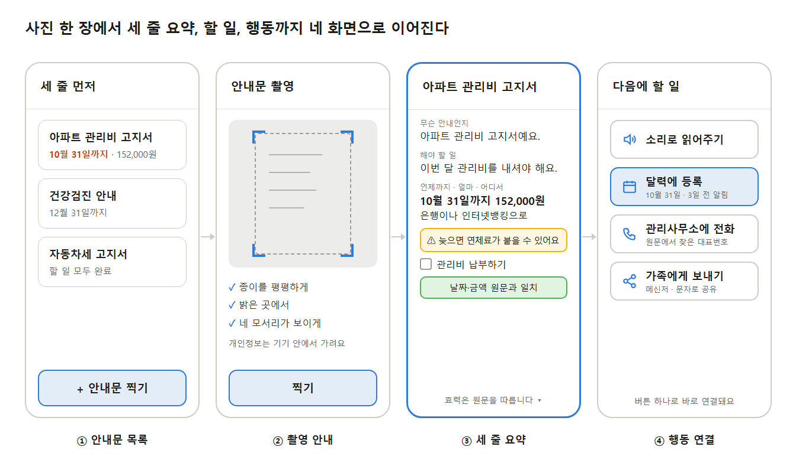
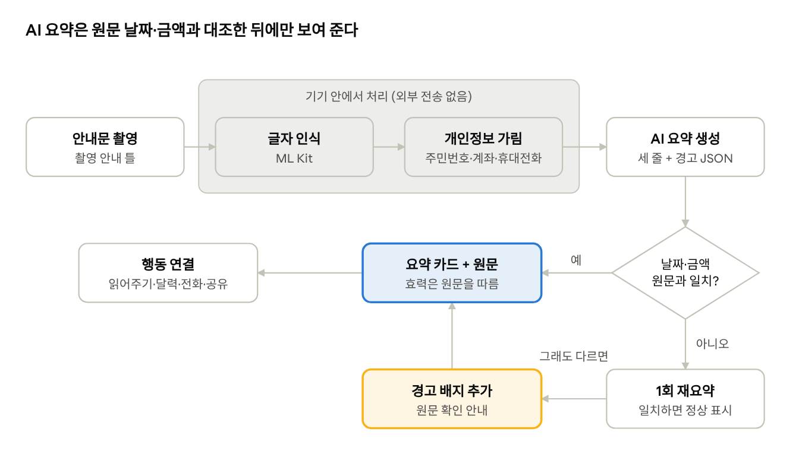

# 세 줄 먼저 – Android Studio 개발 계획서

프로젝트 계획서([project-plan.pptx](project-plan.pptx))의 기능을 Android Studio에서 어떻게 구현할지 정리한 문서입니다. 모든 개발과 빌드, 테스트는 Android Studio에서 진행합니다.



## 1. 프로젝트 생성 설정

Android Studio에서 **New Project → Empty Views Activity**로 만듭니다. 수업에서 다룬 XML 레이아웃을 그대로 쓰기 위해 Compose 템플릿(Empty Activity)이 아닌 Views 템플릿을 고릅니다.

| 항목 | 값 |
| --- | --- |
| Name | ThreeLinesFirst (앱 표시 이름은 `세 줄 먼저`) |
| Package name | `com.kms3735.threelinesfirst` |
| Save location | 이 저장소 폴더 (`three-lines-first/`) |
| Language | Java |
| Minimum SDK | API 26 (Android 8.0) |
| Build configuration language | Kotlin DSL (`build.gradle.kts`, Android Studio 기본값) |

- Minimum SDK 26: 알림 채널(Notification Channel)을 조건문 없이 쓸 수 있고, 국내 사용 기기 대부분을 포함합니다.
- Target/Compile SDK는 Android Studio가 제안하는 최신 버전을 그대로 씁니다.

## 2. 의존성 (`app/build.gradle.kts`)

```kotlin
dependencies {
    // 화면
    implementation("androidx.recyclerview:recyclerview:1.3.2")
    implementation("androidx.cardview:cardview:1.0.0")

    // 촬영: 화면 위 가이드 틀을 그리려고 CameraX 미리보기를 사용
    implementation("androidx.camera:camera-camera2:1.4.2")
    implementation("androidx.camera:camera-lifecycle:1.4.2")
    implementation("androidx.camera:camera-view:1.4.2")

    // 글자 인식 (한국어, 기기 내 처리)
    implementation("com.google.mlkit:text-recognition-korean:16.0.1")

    // 저장 (Week05 Room)
    implementation("androidx.room:room-runtime:2.6.1")
    annotationProcessor("androidx.room:room-compiler:2.6.1")

    // 통신
    implementation("com.squareup.retrofit2:retrofit:2.11.0")
    implementation("com.squareup.retrofit2:converter-gson:2.11.0")

    // 가족 자동 공유 (추가 범위에서 연결)
    implementation(platform("com.google.firebase:firebase-bom:33.7.0"))
    implementation("com.google.firebase:firebase-auth")
    implementation("com.google.firebase:firebase-database")

    testImplementation("junit:junit:4.13.2")
}
```

- 버전은 계획 작성 시점 기준이며, 개발 시작 시 Android Studio가 안내하는 최신 안정 버전으로 맞춥니다.
- Room: Week05 자료에는 `ksp` 플러그인 설정도 있지만, 이 앱은 Java로만 작성하므로 `annotationProcessor` 한 줄이면 됩니다. Kotlin 파일에 Room을 쓸 때만 `ksp`를 추가합니다.
- Firebase는 추가 범위(가족 공유)에서 연결합니다. 필수 범위 개발 단계에서는 Firebase 의존성과 `google-services` 플러그인 없이 진행합니다.

## 3. API 키 관리

Gemini API 키는 `local.properties`에 두고 `BuildConfig`로 읽습니다. `local.properties`는 `.gitignore`에 들어 있어 GitHub에 올라가지 않습니다.

```properties
# local.properties
GEMINI_API_KEY=발급받은_키
```

```kotlin
// app/build.gradle.kts
import java.util.Properties

val localProps = Properties().apply {
    rootProject.file("local.properties").takeIf { it.exists() }?.inputStream()?.use { load(it) }
}

android {
    defaultConfig {
        buildConfigField("String", "GEMINI_API_KEY", "\"${localProps.getProperty("GEMINI_API_KEY", "")}\"")
    }
    buildFeatures { buildConfig = true }
}
```

```java
String key = BuildConfig.GEMINI_API_KEY;
```

> 텀 프로젝트 시연 범위에서는 이 방식을 사용합니다. Play 스토어처럼 불특정 다수에게 배포할 때는 APK에서 키를 꺼낼 수 있으므로, 키를 Firebase Functions 같은 서버로 옮기고 앱은 서버를 거쳐 요청하도록 바꿉니다.

## 4. 권한 (`AndroidManifest.xml`)

```xml
<uses-feature android:name="android.hardware.camera" android:required="true" />

<uses-permission android:name="android.permission.CAMERA" />
<uses-permission android:name="android.permission.INTERNET" />
<uses-permission android:name="android.permission.POST_NOTIFICATIONS" />
<uses-permission android:name="android.permission.RECEIVE_BOOT_COMPLETED" />
```

| 권한 | 쓰는 곳 | 요청 시점 |
| --- | --- | --- |
| `CAMERA` | 안내문 촬영 | 촬영 화면에 처음 들어갈 때 (런타임 요청) |
| `INTERNET` | Gemini API 호출 | 설치 시 자동 |
| `POST_NOTIFICATIONS` | 마감일 알림 (Android 13 이상) | 처음 알림을 켤 때 (런타임 요청) |
| `RECEIVE_BOOT_COMPLETED` | 재부팅 후 알림 다시 예약 | 설치 시 자동 |

달력 등록, 전화 걸기, 공유는 모두 암시적 인텐트로 다른 앱에 맡기므로 **따로 권한이 필요 없습니다.**

- 달력: `Intent.ACTION_INSERT` + `CalendarContract.Events.CONTENT_URI` (사용자가 달력 앱에서 저장을 누름)
- 전화: `Intent.ACTION_DIAL` (번호만 채워진 다이얼 화면, `CALL_PHONE` 권한 불필요)
- 공유: `Intent.ACTION_SEND` + `FileProvider`로 원문 사진 첨부

마감일 알림은 `AlarmManager.setAndAllowWhileIdle()`(정확하지 않은 알람)로 예약합니다. 3일 전·당일 알림은 몇 분 오차가 있어도 되므로, 별도 권한이 필요한 정확한 알람(`SCHEDULE_EXACT_ALARM`)은 쓰지 않습니다.

## 5. 화면 구성

| 화면 | Activity | 레이아웃 | 주요 위젯 |
| --- | --- | --- | --- |
| 개인정보 동의 | `ConsentActivity` | `activity_consent.xml` | 전송 범위 그림, 동의 버튼 |
| ① 안내문 목록 | `MainActivity` | `activity_main.xml`, `item_notice.xml` | RecyclerView + CardView, 촬영 버튼 |
| ② 촬영 안내 | `CaptureActivity` | `activity_capture.xml` | CameraX `PreviewView` + 가이드 틀 오버레이, 인식 결과 확인 |
| ③ 세 줄 요약 | `ResultActivity` | `activity_result.xml` | 세 줄 카드, 경고, 체크박스, 대조 배지, 원문 사진 |
| ④ 행동 연결 | `ResultActivity` 아래쪽 | 같은 레이아웃 | 읽어주기 · 달력 · 전화 · 공유 버튼 |
| 설정 | `SettingsActivity` | `activity_settings.xml` | 쉬운 말, 큰 글씨, 사진 보관, 알림 스위치 |

**화면 이동 흐름**

```
앱 실행 ─(동의 안 함)→ ConsentActivity ─→ MainActivity
MainActivity ─(+ 안내문 찍기)→ CaptureActivity ─(인식 완료)→ ResultActivity
MainActivity ─(목록 항목 누름)→ ResultActivity (notice_id 전달)
```

Activity 사이에는 Room DB의 `notice_id`만 `Intent` extra로 넘기고, 화면에서 DB를 다시 읽습니다. 긴 원문 텍스트나 사진을 Intent에 직접 담지 않습니다.

**접근성 기준을 레이아웃에 적용하는 방법**

- `res/values/dimens.xml`에 본문 20sp, 큰 글씨 28sp를 정의하고, 큰 글씨 모드가 켜져 있으면 화면을 열 때 TextView 크기를 28sp로 바꿔 적용
- 모든 버튼 `android:minHeight="48dp"`, 아이콘과 글자를 함께 표시
- 아이콘 버튼과 이미지에 `android:contentDescription` 지정
- Android Studio의 **Layout Inspector**와 **Accessibility Scanner** 앱으로 터치 영역과 대비를 점검

## 6. 패키지 구조

```
app/src/main/java/com/kms3735/threelinesfirst/
├── ui/
│   ├── MainActivity.java        # 저장한 안내문 목록
│   ├── NoticeAdapter.java       # 목록 RecyclerView 어댑터
│   ├── ConsentActivity.java     # 첫 실행 개인정보 동의
│   ├── CaptureActivity.java     # 촬영 안내, 촬영, 인식 결과 확인
│   ├── ResultActivity.java      # 세 줄 요약, 할 일, 원문, 행동 버튼
│   └── SettingsActivity.java    # 내 모드, 사진 보관, 알림 설정
├── ocr/OcrHelper.java           # ML Kit 글자 인식
├── privacy/PrivacyMasker.java   # 개인정보 가림 (정규식)
├── ai/
│   ├── GeminiApi.java           # Retrofit 인터페이스
│   └── SummaryClient.java       # 프롬프트 구성, 응답 JSON → Notice·Todo 변환, 형식 검사
├── verify/Verifier.java         # 날짜·금액 정규화와 대조, 마감일·전화번호 추출
├── data/
│   ├── AppDatabase.java         # Room @Database
│   ├── Notice.java              # @Entity 안내문 한 건 + 세 줄 요약
│   ├── Todo.java                # @Entity 할 일 체크박스
│   └── NoticeDao.java           # @Dao 조회·저장·수정
└── util/
    ├── ActionIntents.java       # 달력 등록, 전화, 공유 인텐트
    ├── DeadlineAlarm.java       # 알림 예약 + BroadcastReceiver
    └── TtsHelper.java           # TextToSpeech 래퍼
```

`PrivacyMasker`와 `Verifier`는 안드로이드 API를 쓰지 않는 순수 Java 클래스로 만들어, 기기 없이 JUnit 단위 테스트로 검증합니다.

## 7. 핵심 처리 흐름 구현



| 단계 | 클래스 | 구현 방법 | 스레드 |
| --- | --- | --- | --- |
| 1. 촬영 | `CaptureActivity` | CameraX `ImageCapture`로 앱 내부 저장소에 JPG 저장 | CameraX 내부 |
| 2. 글자 인식 | `OcrHelper` | `TextRecognition.getClient(new KoreanTextRecognizerOptions.Builder().build())` | ML Kit `Task` 콜백 |
| 3. 인식 결과 확인 | `CaptureActivity` | 인식된 글자가 너무 적으면(예: 30자 미만) 다시 찍기 안내, 요약으로 넘어가지 않음 | 메인 |
| 4. 개인정보 가림 | `PrivacyMasker` | 주민등록번호, 개인 휴대전화(010), 계좌번호, 주소, "성명:" 뒤 이름을 `●●●`로 치환 | 메인 (짧은 문자열) |
| 5. AI 요약 | `SummaryClient` | Retrofit으로 Gemini `generateContent` 호출, JSON 응답 고정 | Retrofit `enqueue` |
| 6. 형식 검사 | `SummaryClient` | 필수 필드가 없거나 비면 1회 재요청 | 콜백 |
| 7. 날짜·금액 대조 | `Verifier` | 원문·요약의 날짜와 금액을 정규화해 비교, 불일치 시 1회 재요약 후 경고 배지 | 콜백 |
| 8. 저장과 표시 | `NoticeDao`, `ResultActivity` | Room에 저장 후 `Handler`로 화면 표시, 마감일 알림 예약 | 저장은 백그라운드, 표시는 메인 |

### Gemini API 호출

```java
public interface GeminiApi {
    @POST("v1beta/models/{model}:generateContent")
    Call<JsonObject> generate(@Path("model") String model,
                              @Header("x-goog-api-key") String key,
                              @Body JsonObject body);
}
```

- Base URL: `https://generativelanguage.googleapis.com/`
- 모델: 무료 사용량이 넉넉한 Flash 계열 (예: `gemini-2.5-flash`, 개발 시점의 최신 Flash 모델로 교체)
- 요청의 `generationConfig`에 `"responseMimeType": "application/json"`과 `responseSchema`를 넣어 아래 형식으로만 답하게 고정합니다.

```json
{
  "line1_what": "아파트 관리비 고지서예요.",
  "line2_todo": "이번 달 관리비를 내셔야 해요.",
  "line3_when_where": "10월 31일까지 152,000원을 은행이나 인터넷뱅킹으로 내요.",
  "warning": "기한이 지나면 연체료가 붙을 수 있어요.",
  "todos": ["관리비 납부하기"],
  "deadline": "2026-10-31",
  "amounts": [152000]
}
```

- "이해가 안 돼요"는 같은 원문에 "더 쉬운 말로, 초등학생도 이해하게" 조건을 붙여 다시 요청합니다.
- 실패하면 "원문을 확인해 주세요" 안내와 재시도 버튼을 보여 주고, 하루 요청 횟수를 `SharedPreferences`에 세어 제한합니다.

### 날짜·금액 대조 규칙

| 원문 표기 | 정규화 결과 |
| --- | --- |
| `2026. 10. 31.`, `2026-10-31`, `10월 31일` | `2026-10-31` (연도가 없으면 촬영 연도, 지난 날짜면 다음 해) |
| `152,000원`, `152000원`, `15만 2천원` | `152000` |

요약에 나온 날짜·금액이 모두 원문 목록 안에 있으면 통과입니다. 원문에 날짜가 여러 개면 "까지", "마감", "기한" 주변 날짜를 마감일 후보로 우선 고르고, 그래도 불확실하면 후보를 보여 주고 사용자가 고르게 합니다.

## 8. 데이터 저장

**Room (Week05)**

Room은 SQLite 위에서 동작하므로 계획서의 "SQLite 저장"과 같은 구조이고, 수업에서 권장한 대로 `SQLiteOpenHelper` 대신 Entity·DAO·Database 세 가지로 나눕니다.

| Entity (테이블) | 주요 필드 | 내용 |
| --- | --- | --- |
| `Notice` (`notice`) | id, title, maskedText, imagePath, line1What, line2Todo, line3WhenWhere, warning, deadline, amount, phone, verified, createdAt | 안내문 한 건, 세 줄 요약, 대조 결과 |
| `Todo` (`todo`) | id, noticeId, content, done | 할 일 체크박스 |

```java
@Dao
public interface NoticeDao {
    @Query("SELECT * FROM notice ORDER BY createdAt DESC")
    List<Notice> getAll();

    @Query("SELECT * FROM todo WHERE noticeId = :noticeId")
    List<Todo> getTodos(long noticeId);

    @Insert long insert(Notice notice);
    @Insert void insertTodos(List<Todo> todos);
    @Update void updateTodo(Todo todo);   // 체크박스 상태
    @Delete void delete(Notice notice);
}
```

- 요약은 안내문 한 건에 하나뿐이라 `Notice`에 함께 두고, 개수가 정해지지 않은 할 일만 `Todo`로 나눕니다.
- `AppDatabase`는 `Room.databaseBuilder(...)`로 앱 전체에서 한 번만 만들어 씁니다.

**DB와 네트워크는 메인 스레드에서 하지 않습니다 (Week06)**

Week05 예제의 `allowMainThreadQueries()`는 실습용이라 쓰지 않습니다. 메인 스레드에서 DB를 읽으면 화면이 멈추거나 ANR이 생길 수 있으므로, Week06에서 배운 대로 백그라운드 스레드에서 처리하고 `Handler`로 화면을 고칩니다.

```java
private final Handler uiHandler = new Handler(Looper.getMainLooper());

private void loadNotices() {
    new Thread(() -> {
        List<Notice> notices = db.noticeDao().getAll();        // 백그라운드 스레드
        uiHandler.post(() -> adapter.setItems(notices));       // 메인 스레드에서 화면 갱신
    }).start();
}
```

Retrofit(`enqueue`)과 ML Kit(`Task` 콜백)은 라이브러리가 알아서 백그라운드에서 처리하고 결과를 메인 스레드로 돌려주므로 따로 스레드를 만들지 않습니다.

**내부 저장소 (Week05 File I/O)**

- 원문 사진은 앱 내부 저장소(`getFilesDir()`)에만 저장합니다. 다른 앱이 접근할 수 없고, 앱을 지우면 함께 지워집니다.
- 사진 보관을 끄면 요약 후 파일을 지우고 `imagePath`를 비웁니다.
- 가린 텍스트(`maskedText`)만 저장하고, 가리기 전 원문 텍스트는 저장하지 않습니다.
- Android Studio의 **Device File Explorer**에서 `/data/data/com.kms3735.threelinesfirst/` 아래 `files/`(사진)와 `databases/`(Room DB)가 제대로 생겼는지 확인합니다.

**SharedPreferences**

| 키 | 값 |
| --- | --- |
| `consent_agreed` | 개인정보 동의 여부 |
| `easy_mode` | 쉬운 말 모드 |
| `large_text` | 큰 글씨 모드 |
| `keep_photo` | 원문 사진 보관 여부 |
| `daily_request_count`, `daily_request_date` | 하루 AI 요청 횟수 제한 |

## 9. 개발 순서

기획서의 범위 구분(필수 → 추가 → 향후)대로, 정확성 장치가 들어간 핵심 흐름을 먼저 완성합니다.

| 단계 | 범위 | 할 일 | 완료 기준 |
| --- | --- | --- | --- |
| 0 | 준비 | 프로젝트 생성, 의존성·권한 추가, API 키 설정, 실제 안내문 샘플 5종 수집 | 빈 앱이 실제 기기에서 실행됨 |
| 1 | 필수 | 촬영 안내 화면, CameraX 촬영, ML Kit 글자 인식, 인식 결과 확인 | 샘플 5종 모두 글자가 추출됨 |
| 2 | 필수 | `PrivacyMasker` + 단위 테스트, 개인정보 동의 화면 | 테스트 문장의 주민번호·계좌·휴대전화가 모두 가려짐 |
| 3 | 필수 | Gemini 호출, JSON 형식 검사, 세 줄 카드·경고·체크박스 화면 | 샘플 5종이 세 줄 형식으로 표시됨 |
| 4 | 필수 | `Verifier` + 단위 테스트, 재요약과 경고 배지, 원문 나란히 보기 | 날짜를 일부러 틀린 요약에 경고 배지가 붙음 |
| 5 | 필수 | Room 저장, 안내문 목록 화면 | 앱을 껐다 켜도 목록과 체크 상태가 남아 있음 |
| 6 | 추가 | 읽어주기, 달력 등록, 전화 걸기, 가족에게 보내기, 마감일 알림 | 버튼마다 해당 앱이 열리고, 알림이 예약됨 |
| 7 | 추가 | 쉬운 말·큰 글씨 모드, "이해가 안 돼요" 재요약, Firebase 가족 공유 | 설정이 모든 문서에 적용됨 |
| 8 | 마무리 | 샘플로 정확도 점검, 접근성 점검, 서명된 APK 빌드 | 실기기에 APK를 설치해 전체 흐름이 동작함 |

## 10. 테스트와 빌드

| 종류 | 방법 |
| --- | --- |
| 단위 테스트 | `app/src/test/`에 `PrivacyMaskerTest`, `VerifierTest` 작성, Android Studio에서 클래스 옆 ▶ 실행 |
| 실제 기기 테스트 | 휴대폰 **개발자 옵션 → USB 디버깅**을 켜고 USB 연결, 상단 기기 목록에서 선택 후 Run |
| 에뮬레이터 | 화면 배치와 설정 확인용 (카메라 촬영과 글자 인식은 실제 기기 권장) |
| 로그 확인 | **Logcat**에서 `SummaryClient`, `Verifier` 태그로 AI 응답과 대조 결과 확인 |
| 시연용 APK | **Build → Generate Signed App Bundle / APK → APK**, 만든 keystore 파일은 Git에 올리지 않음 (`.gitignore`에 `*.jks` 포함) |

## 11. 수업 내용 적용

| 주차 | 수업 내용 | 이 앱에서 쓰는 곳 |
| --- | --- | --- |
| Week01 | Android Studio 프로젝트 생성, 에뮬레이터 실행 | 1절 프로젝트 생성 설정 |
| Week02 | 기본 위젯 (TextView, Button, CheckBox 등) | 세 줄 카드, 할 일 체크박스, 행동 버튼 |
| Week03 | 레이아웃 (ConstraintLayout, LinearLayout, weight) | 모든 화면 배치, 큰 글씨 모드 |
| Week03-1 | 앱 구성 요소, Activity 생명주기 | Activity 6개, `onPause`에서 읽어주기 정지, BroadcastReceiver(알림) |
| Week05 | 내부 저장소 File I/O, SharedPreferences, Room | 원문 사진 저장, 내 모드 설정, 안내문·할 일 저장 |
| Week06 | Thread, Handler, Looper | DB 작업을 백그라운드 스레드에서 처리하고 Handler로 화면 갱신 |

**수업 내용과 다르게 구현하는 부분**

| 수업 내용 | 이 앱에서 쓰는 것 | 이유 |
| --- | --- | --- |
| `allowMainThreadQueries()` (Week05 실습) | `Thread` + `Handler` (Week06) | 메인 스레드에서 DB를 다루면 화면이 멈출 수 있음 |
| Room `ksp` 설정 (Week05) | `annotationProcessor`만 사용 | Java로만 작성하므로 `ksp`가 필요 없음 |
| 카메라 인텐트 | CameraX | 촬영 화면 위에 가이드 틀을 그려야 함 |
| `AsyncTask`, `IntentService` | `Thread` + `Handler`, `AlarmManager` + `BroadcastReceiver` | 최신 안드로이드에서 사용 중단됨 |

향후 개선 과제로 알림 예약의 WorkManager 전환을 둡니다.
