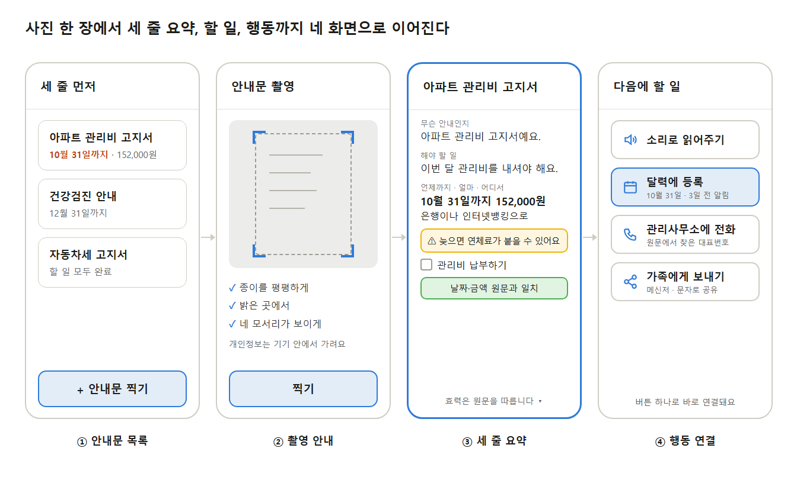
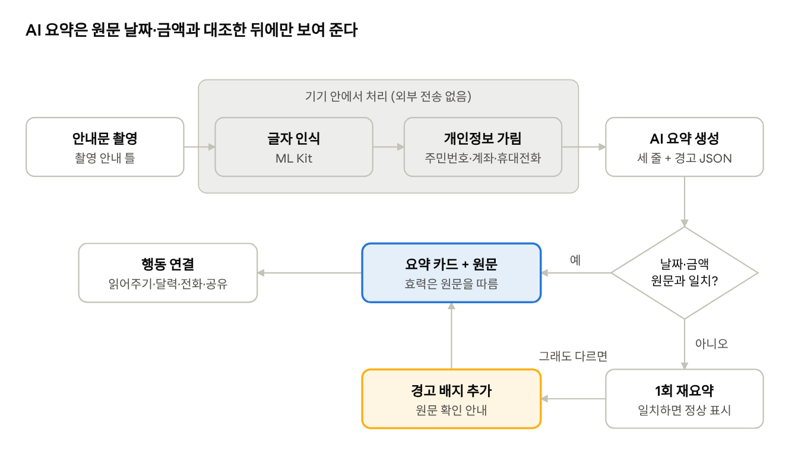

# 세 줄 먼저 – Android Studio 개발 계획서

프로젝트 계획서([project-plan.pdf](project-plan.pdf))의 기능을 Android Studio에서 어떻게 구현할지 정리한 문서입니다. 모든 개발과 빌드, 테스트는 Android Studio에서 진행합니다.



## 1. 프로젝트 생성 설정

Android Studio에서 **New Project → Empty Views Activity**로 만듭니다. 화면을 XML 레이아웃으로 구성하기 위해 Compose 템플릿(Empty Activity)이 아닌 Views 템플릿을 고릅니다.

| 항목 | 값 |
| --- | --- |
| **Name** | ThreeLinesFirst (앱 표시 이름 `세 줄 먼저`) |
| **Package name** | `com.kms3735.threelinesfirst` |
| **Save location** | 이 저장소 폴더 `three-lines-first/` |
| **Language** | Java |
| **Minimum SDK** | API 26 (Android 8.0) |
| **Build configuration** | Kotlin DSL (`build.gradle.kts`, 기본값) |

- Minimum SDK 26: 알림 채널(Notification Channel)을 조건문 없이 쓸 수 있고, 국내 사용 기기 대부분을 포함합니다.
- Target/Compile SDK는 Android Studio가 제안하는 최신 버전을 그대로 씁니다.

## 2. 의존성 (`app/build.gradle.kts`)

```kotlin
dependencies {
    // 화면
    implementation("androidx.recyclerview:recyclerview:1.3.2")
    implementation("androidx.cardview:cardview:1.0.0")

    // 촬영: 화면 위 가이드 틀을 그리려고 CameraX 미리보기를 사용
    implementation("androidx.camera:camera-camera2:1.4.2")
    implementation("androidx.camera:camera-lifecycle:1.4.2")
    implementation("androidx.camera:camera-view:1.4.2")

    // 글자 인식 (한국어, 기기 내 처리)
    implementation("com.google.mlkit:text-recognition-korean:16.0.1")

    // 저장 (Room)
    implementation("androidx.room:room-runtime:2.6.1")
    annotationProcessor("androidx.room:room-compiler:2.6.1")

    // 통신
    implementation("com.squareup.retrofit2:retrofit:3.0.0")
    implementation("com.squareup.retrofit2:converter-gson:3.0.0")

    // 장소 지도 보기: 현재 위치와 지도 (추가 범위에서 연결)
    implementation("com.google.android.gms:play-services-location:21.4.0")
    implementation("com.google.android.gms:play-services-maps:20.1.0")

    // 가족 자동 공유 (추가 범위에서 연결)
    implementation(platform("com.google.firebase:firebase-bom:33.7.0"))
    implementation("com.google.firebase:firebase-auth")
    implementation("com.google.firebase:firebase-firestore")

    testImplementation("junit:junit:4.13.2")
}
```

- 버전은 계획 작성 시점 기준이며, 개발 시작 시 Android Studio가 안내하는 최신 안정 버전으로 맞춥니다.
- Room: 앱을 Java로만 작성하므로 `ksp` 플러그인 없이 `annotationProcessor`로 Room 컴파일러를 연결합니다.
- Firebase는 추가 범위(가족 공유)에서 연결합니다. 필수 범위 개발 단계에서는 Firebase 의존성과 `google-services` 플러그인 없이 진행합니다.

## 3. API 키 관리

Gemini API 키는 `local.properties`에 두고 `BuildConfig`로 읽습니다. `local.properties`는 `.gitignore`에 들어 있어 GitHub에 올라가지 않습니다.

```properties
# local.properties
GEMINI_API_KEY=발급받은_키
MAPS_API_KEY=발급받은_지도_키
```

지도 키(`MAPS_API_KEY`)는 Google Cloud 콘솔에서 Maps SDK for Android를 켜고 발급하며, 앱 패키지 이름으로 사용을 제한합니다. 지도 키는 `AndroidManifest.xml`의 `com.google.android.geo.API_KEY` 메타데이터로 들어가야 하므로, 같은 `local.properties`에서 읽어 `manifestPlaceholders`로 넣습니다.

```kotlin
manifestPlaceholders["MAPS_API_KEY"] = localProps.getProperty("MAPS_API_KEY", "")
```

```kotlin
// app/build.gradle.kts
import java.util.Properties

val localProps = Properties().apply {
    rootProject.file("local.properties").takeIf { it.exists() }?.inputStream()?.use { load(it) }
}

android {
    defaultConfig {
        buildConfigField("String", "GEMINI_API_KEY", "\"${localProps.getProperty("GEMINI_API_KEY", "")}\"")
    }
    buildFeatures { buildConfig = true }
}
```

```java
String key = BuildConfig.GEMINI_API_KEY;
```

> 텀 프로젝트 시연 범위에서는 이 방식을 사용합니다. Play 스토어처럼 불특정 다수에게 배포할 때는 APK에서 키를 꺼낼 수 있으므로, 키를 Firebase Functions 같은 서버로 옮기고 앱은 서버를 거쳐 요청하도록 바꿉니다.

## 4. 권한 (`AndroidManifest.xml`)

```xml
<uses-feature android:name="android.hardware.camera" android:required="true" />

<uses-permission android:name="android.permission.CAMERA" />
<uses-permission android:name="android.permission.INTERNET" />
<uses-permission android:name="android.permission.POST_NOTIFICATIONS" />
<uses-permission android:name="android.permission.RECEIVE_BOOT_COMPLETED" />
<uses-permission android:name="android.permission.ACCESS_COARSE_LOCATION" />
<uses-permission android:name="android.permission.ACCESS_FINE_LOCATION" />
```

| 권한 | 쓰는 곳 | 요청 시점 |
| --- | --- | --- |
| **`CAMERA`** | 안내문 촬영 | 촬영 화면에 처음 들어갈 때 (런타임 요청) |
| **`INTERNET`** | Gemini API 호출 | 설치 시 자동 |
| **`POST_NOTIFICATIONS`** | 마감일 알림 (Android 13 이상) | 처음 알림을 켤 때 (런타임 요청) |
| **`RECEIVE_BOOT_COMPLETED`** | 재부팅 후 알림 다시 예약 | 설치 시 자동 |
| **`ACCESS_FINE_LOCATION`**<br>**`ACCESS_COARSE_LOCATION`** | 장소 지도에 내 위치 표시 | "장소 보기"를 처음 누를 때 (런타임 요청)<br>거절해도 장소 표시는 그대로 |

**장소 지도 보기**

안내문에 적힌 기관(행정복지센터, 구청, 검진기관 등)을 지도에 표시해, 어르신이 어디로 가야 하는지 바로 볼 수 있게 합니다.

- AI 요약 결과에 장소 이름(`place`) 칸을 추가하고, `Geocoder`로 장소 이름을 좌표로 바꿉니다. 직접 가야 하는 곳이 없거나 여러 곳 중 고르는 안내문은 `place`를 비워 버튼을 숨깁니다.
- 문의 전화(`phone`)도 AI가 옮기되, 숫자가 원문에 그대로 있을 때만 남깁니다(`Verifier.phoneIn`). 글자 인식이 숫자 사이에 공백을 넣어도 숫자만 비교해 찾습니다.
- `FusedLocationProviderClient.getLastLocation()`으로 현재 위치를 받아, 같은 이름의 기관이 여러 곳이면 가까운 곳을 고릅니다.
- `SupportMapFragment`에 장소 마커와 내 위치(`setMyLocationEnabled`)를 함께 보여 줍니다.
- 위치는 기기 안에서 지도 표시에만 쓰고, AI로 보내거나 저장하지 않습니다.

달력 등록, 전화 걸기, 공유는 모두 암시적 인텐트로 다른 앱에 맡기므로 **따로 권한이 필요 없습니다.**

- 달력: `Intent.ACTION_INSERT` + `CalendarContract.Events.CONTENT_URI` (사용자가 달력 앱에서 저장을 누름)
- 전화: `Intent.ACTION_DIAL` (번호만 채워진 다이얼 화면, `CALL_PHONE` 권한 불필요)
- 공유: `Intent.ACTION_SEND` + `FileProvider`로 원문 사진 첨부

**온라인 안내문 입력 (계획서 검토 피드백 반영)**

종이 안내문뿐 아니라 문자, 카카오톡, 전자고지처럼 온라인으로 받은 안내문도 처리합니다. 두 경로 모두 **추가 권한이 필요 없습니다.**

- 사진·캡처 불러오기: `ActivityResultContracts.PickVisualMedia` (사진 선택기). 사용자가 고른 사진 한 장만 앱에 전달되므로 저장소 권한을 요청하지 않습니다.
- 공유로 받기: `CaptureActivity`에 아래 인텐트 필터를 등록해 다른 앱의 공유 목록에 "세 줄 먼저"가 나타나게 합니다.

```xml
<intent-filter>
    <action android:name="android.intent.action.SEND" />
    <category android:name="android.intent.category.DEFAULT" />
    <data android:mimeType="image/*" />
    <data android:mimeType="text/plain" />
</intent-filter>
```

| 받은 내용 | 처리 |
| --- | --- |
| **이미지** (`EXTRA_STREAM`) | 내부 저장소로 복사한 뒤 촬영 사진과 같은 방식으로 글자 인식 |
| **글** (`EXTRA_TEXT`) | 글자 인식 없이 바로 개인정보 가림 단계로 전달 |

마감일 알림은 마감 3일 전과 당일 오전 9시에 `AlarmManager.setWindow()`로 15분 안에 울리게 예약합니다. 몇 분 오차가 있어도 되므로 별도 권한이 필요한 정확한 알람(`SCHEDULE_EXACT_ALARM`)은 쓰지 않습니다. `set()`이나 `setAndAllowWhileIdle()`은 남은 시간의 75%까지 늦어질 수 있어(2주 뒤 알림이 열흘 넘게 밀림) 쓰지 않습니다.

- 휴대폰을 다시 켜면 예약이 사라지므로 `BOOT_COMPLETED`를 받아 저장된 안내문으로 다시 예약합니다.
- 알림 글은 인텐트가 아니라 DB에서 읽어, 지운 안내문은 알리지 않고 다른 앱이 가짜 알림 내용을 넣을 수 없게 합니다.
- 알림을 누르면 그 안내문의 요약 화면이 열립니다.

## 5. 화면 구성

| 화면 | Activity · 레이아웃 | 주요 위젯 |
| --- | --- | --- |
| **개인정보 동의** | `ConsentActivity`<br>`activity_consent.xml` | 전송 범위 그림, 동의 버튼 |
| **① 안내문 목록** | `MainActivity`<br>`activity_main.xml` · `item_notice.xml` | 인사말, 가장 급한 안내문 카드, 마감 임박·진행 중·마감 지남 개수<br>RecyclerView + CardView (마감이 가까운 순, 날짜 칸)<br>사진 불러오기 · 안내문 찍기 버튼 |
| **② 촬영 안내** | `CaptureActivity`<br>`activity_capture.xml` | CameraX `PreviewView` + 가이드 틀<br>인식 결과 확인<br>사진·공유로 들어오면 카메라를 건너뜀 |
| **③ 세 줄 요약** | `ResultActivity`<br>`activity_result.xml` | 세 쪽으로 나눠 위쪽 탭과 아래 버튼으로 넘김<br>1 요약: 대조 배지, 번호 붙은 세 줄 카드, 경고, 듣기<br>3 원문: 원문 사진(크게 보기), 가린 글, 지우기 |
| **④ 행동 연결** | `ResultActivity` 2쪽<br>`item_todo.xml` · `item_tile.xml` | 할 일 체크박스<br>바로 하기 칸: 달력 · 문의 전화 · 가족에게 보내기 · 지도<br>마감일 알림 안내 |
| **장소 지도** | `MapActivity`<br>`activity_map.xml` | `SupportMapFragment`<br>기관 마커, 내 위치<br>아래 판: 주소, 가기 전에 전화로 묻기 |
| **설정** | `SettingsActivity`<br>`activity_settings.xml` | 큰 글씨·쉬운 말 스위치, 알림 설정 열기 |

**화면 이동 흐름**

```
앱 실행 ─(동의 안 함)→ ConsentActivity ─→ MainActivity
MainActivity ─(+ 안내문 찍기)→ CaptureActivity ─(인식 완료)→ ResultActivity
MainActivity ─(사진 불러오기)→ CaptureActivity (사진 Uri 전달, 카메라 건너뜀)
다른 앱 ─(공유)→ CaptureActivity (이미지는 글자 인식, 글은 바로 다음 단계)
MainActivity ─(목록 항목 누름)→ ResultActivity (notice_id 전달)
```

Activity 사이에는 Room DB의 `notice_id`만 `Intent` extra로 넘기고, 화면에서 DB를 다시 읽습니다. 긴 원문 텍스트나 사진을 Intent에 직접 담지 않습니다.

**접근성 기준을 레이아웃에 적용하는 방법**

- `res/values/dimens.xml`에 본문 20sp를 정의하고, 큰 글씨 모드가 켜져 있으면 모든 화면의 부모 `BaseActivity`가 글자 배율(fontScale)을 1.4배로 키워 본문이 28sp가 됨. 휴대폰 설정의 글자 크기 위에 곱하므로 사용자가 고른 크기도 살아 있음
- 모든 버튼 `android:minHeight="48dp"`, 아이콘과 글자를 함께 표시
- 아이콘 버튼과 이미지에 `android:contentDescription` 지정
- 한국어를 낱말 단위로 줄바꿈: Android 13 이상은 테마의 `lineBreakWordStyle=phrase`, 그 아래는 `KeepWords`가 낱말 안 글자 사이에 보이지 않는 WORD JOINER(U+2060)를 넣어 "안내문이 / 에요."처럼 끊기지 않게 함. 코드에서 나중에 넣은 글도 `BaseActivity`가 그리기 직전에 한꺼번에 적용
- 색은 `values/colors.xml`과 `values-night/colors.xml`에 같은 이름으로 두어 어두운 모드에서도 대비를 유지
- Android Studio의 **Layout Inspector**와 **Accessibility Scanner** 앱으로 터치 영역과 대비를 점검

## 6. 패키지 구조

```
app/src/main/java/com/kms3735/threelinesfirst/
├── ui/
│   ├── BaseActivity.java        # 모든 화면의 부모: 큰 글씨, 낱말 단위 줄바꿈
│   ├── MainActivity.java        # 저장한 안내문 목록
│   ├── NoticeAdapter.java       # 목록 RecyclerView 어댑터
│   ├── ConsentActivity.java     # 첫 실행 개인정보 동의
│   ├── CaptureActivity.java     # 촬영 안내, 촬영, 사진·공유로 받기, 인식 결과 확인
│   ├── ResultActivity.java      # 세 줄 요약 세 쪽(요약 / 할 일·바로 하기 / 원문), 읽어주기·달력·전화·공유
│   ├── MapActivity.java         # 장소 지도: 내 위치 + 기관 마커
│   └── SettingsActivity.java    # 큰 글씨, 쉬운 말, 알림 설정
├── ocr/                         # OcrHelper (ML Kit 글자 인식), ReadingOrder (읽는 순서 정렬)
├── privacy/PrivacyMasker.java   # 개인정보 가림 (정규식)
├── ai/
│   ├── GeminiApi.java           # Retrofit 인터페이스
│   └── SummaryClient.java       # 프롬프트 구성, 응답 JSON → Notice·Todo 변환, 형식 검사
├── verify/Verifier.java         # 날짜·금액 정규화와 대조, 마감일·전화번호 추출
├── data/
│   ├── AppDatabase.java         # Room @Database
│   ├── Notice.java              # @Entity 안내문 한 건 + 세 줄 요약
│   ├── Todo.java                # @Entity 할 일 체크박스
│   └── NoticeDao.java           # @Dao 조회·저장·수정
└── util/
    ├── DeadlineAlarm.java       # 알림 예약 + BroadcastReceiver (알림, BOOT_COMPLETED)
    └── KeepWords.java           # 한국어 낱말 단위 줄바꿈 (Android 12 이하)
```

달력·전화·공유 인텐트와 `TextToSpeech`는 각각 몇 줄이고 요약 화면에서만 쓰므로 `ResultActivity` 안에 둡니다.

`PrivacyMasker`와 `Verifier`는 안드로이드 API를 쓰지 않는 순수 Java 클래스로 만들어, 기기 없이 JUnit 단위 테스트로 검증합니다.

## 7. 핵심 처리 흐름 구현



| 단계 | 클래스 | 구현 방법 | 스레드 |
| --- | --- | --- | --- |
| **1. 촬영 · 입력** | `CaptureActivity` | CameraX `ImageCapture`로 내부 저장소에 JPG 저장<br>또는 불러온 사진·공유받은 이미지를 내부 저장소로 복사 | CameraX 내부 |
| **2. 글자 인식** | `OcrHelper`<br>`ReadingOrder` | ML Kit `KoreanTextRecognizerOptions`로 인식<br>줄 위치로 정렬해 표의 항목과 내용을 같은 줄로 맞춤<br>공유받은 글은 이 단계를 건너뜀 | ML Kit 콜백 |
| **3. 인식 결과 확인** | `CaptureActivity` | 글자가 너무 적으면(30자 미만) 다시 찍기 안내 | 메인 |
| **4. 개인정보 가림** | `PrivacyMasker` | 주민번호 · 휴대전화(010) · 계좌 · 주소 · 이름을 `[주민번호]`, `[계좌번호]`처럼 종류를 밝혀 치환<br>숫자 사이 공백, 잘못 읽힌 글자가 끼어도 가리고, 기관 대표번호는 남김 | 메인 |
| **5. AI 요약** | `SummaryClient` | Retrofit으로 Gemini `generateContent` 호출, JSON 응답 고정 | Retrofit `enqueue` |
| **6. 형식 검사** | `SummaryClient` | 필수 필드가 없거나 비면 1회 재요청 | 콜백 |
| **7. 날짜·금액 대조** | `Verifier` | 정규화해 비교, 불일치 시 1회 재요약 후 경고 배지 | 콜백 |
| **8. 저장과 표시** | `NoticeDao`<br>`ResultActivity` | Room에 저장 후 `Handler`로 화면 표시, 알림 예약 | 저장 백그라운드<br>표시 메인 |

### Gemini API 호출

```java
public interface GeminiApi {
    @POST("v1beta/models/{model}:generateContent")
    Call<JsonObject> generate(@Path("model") String model,
                              @Header("x-goog-api-key") String key,
                              @Body JsonObject body);
}
```

- Base URL: `https://generativelanguage.googleapis.com/`
- 모델: 빠른 `gemini-3.5-flash-lite`로 요청하고, 형식이 틀리거나 서버가 붐비면 `gemini-3.5-flash`로 한 번 더 요청합니다. 모델이 닫히면 `SummaryClient`의 모델 이름만 바꿉니다.
- 요청의 `generationConfig`에 `"responseMimeType": "application/json"`과 `responseSchema`를 넣어 아래 형식으로만 답하게 고정합니다.

```json
{
  "line1_what": "아파트 관리비 고지서예요.",
  "line2_todo": "이번 달 관리비를 내셔야 해요.",
  "line3_when_where": "10월 31일까지 152,000원을 은행이나 인터넷뱅킹으로 내요.",
  "warning": "기한이 지나면 연체료가 붙을 수 있어요.",
  "todos": ["관리비 납부하기"],
  "deadline": "2026-10-31",
  "amounts": [152000]
}
```

- "이해가 안 돼요"는 같은 원문에 "더 쉬운 말로, 초등학생도 이해하게" 조건을 붙여 다시 요청합니다.
- 실패하면 "원문을 확인해 주세요" 안내와 재시도 버튼을 보여 주고, 하루 요청 횟수를 `SharedPreferences`에 세어 제한합니다.

### 날짜·금액 대조 규칙

| | 원문 표기 | 정규화 결과 |
| :---: | --- | --- |
| | `2026. 10. 31.` · `2026-10-31` · `10월 31일` | **`2026-10-31`**<br>연도가 없으면 촬영 연도, 지난 날짜면 다음 해 |
| | `152,000원` · `152000원` · `15만 2천원` | **`152000`** |

요약의 마감일 칸, 금액 칸, 그리고 사용자가 읽는 세 줄·경고·할 일 문장 속 날짜·금액이 모두 원문 목록 안에 있으면 통과입니다.

- 원문에 "까지", "마감", "기한", "납기"가 있는 줄의 날짜를 마감일 후보로 보고, 마감일은 후보 중 하나여야 합니다. 부과 기간이나 위반 일시처럼 원문에 있지만 마감일이 아닌 날짜를 고르면 잡아냅니다.
- 글자 인식 오류를 견딥니다: 월을 "원"으로 읽은 날짜(`10원 31일`), 쉼표 옆 공백(`152, 000`), 표 금액의 "원" 빠짐(`152,000`), "원"을 `l`로 읽음(`40,000l`).
- 다르면 다른 값을 알려 주며 한 번 다시 요약합니다. 그래도 다르면 주황 경고 배지에 그 값을 보여 주고, 원문 사진을 요약 바로 아래에 펼쳐 비교하게 합니다. 통과하면 초록 체크 배지를 붙입니다.
- `VerifierTest`는 샘플 5종의 실제 인식 결과(`app/src/test/resources/ocr/`)로 정답 통과와 틀린 날짜·금액 검출을 확인합니다.

## 8. 데이터 저장

**Room**

Room은 SQLite 위에서 동작하는 라이브러리로, `SQLiteOpenHelper` 대신 Entity·DAO·Database 세 가지로 나눠 저장 구조를 관리합니다.

| Entity | 담는 내용 | 주요 필드 |
| --- | --- | --- |
| **`Notice`** | 안내문 정보 | `maskedText` · `imagePath` · `createdAt` |
| | 세 줄 요약 | `line1What` · `line2Todo` · `line3WhenWhere` · `warning` |
| | 요약 속 값 | `deadline` · `amounts` |
| | 대조 결과 | `checkedCount` · `mismatches` |
| | 행동 연결 | `phone`(원문에 있는 번호만) · `place` |
| **`Todo`** | 할 일 체크박스 | `noticeId` · `content` · `done` |

```java
@Dao
public interface NoticeDao {
    // 목록: 최근 것부터, 할 일 진행 개수(todoTotal, todoDone)와 함께 NoticeItem으로 받는다
    // (화면에서는 마감이 가까운 순으로 다시 정렬한다)
    @Query("SELECT n.*, (SELECT COUNT(*) ...) AS todoTotal, (SELECT COUNT(*) ... done = 1) AS todoDone "
            + "FROM notice n ORDER BY n.createdAt DESC")
    List<NoticeItem> getList();

    @Query("SELECT * FROM todo WHERE noticeId = :noticeId ORDER BY id")
    List<Todo> getTodos(long noticeId);

    @Insert long insert(Notice notice);
    @Update void updateTodo(Todo todo);   // 체크박스 상태
    @Delete void delete(Notice notice);   // 할 일은 외래 키 CASCADE로 함께 지워짐

    @Transaction                          // 요약과 할 일을 한 번에 저장
    default void saveSummary(Notice notice, List<Todo> todos) { ... }
}
```

- 요약은 안내문 한 건에 하나뿐이라 `Notice`에 함께 두고, 개수가 정해지지 않은 할 일만 `Todo`로 나눕니다.
- 안내문은 요약하기 전에 먼저 저장합니다(`line1What`이 null이면 요약 전). 요약에 실패해도 목록에서 눌러 다시 시도할 수 있고, 이미 요약한 안내문은 AI를 다시 부르지 않습니다.
- `AppDatabase`는 `Room.databaseBuilder(...)`로 앱 전체에서 한 번만 만들어 씁니다.

**DB와 네트워크는 메인 스레드에서 하지 않습니다**

`allowMainThreadQueries()`는 쓰지 않습니다. 메인 스레드에서 DB를 읽으면 화면이 멈추거나 ANR이 생길 수 있으므로, 백그라운드 스레드에서 처리하고 `Handler`로 화면을 고칩니다.

```java
private final Handler uiHandler = new Handler(Looper.getMainLooper());

private void loadNotices() {
    new Thread(() -> {
        List<NoticeItem> items = db.noticeDao().getList();     // 백그라운드 스레드
        uiHandler.post(() -> adapter.setItems(items));         // 메인 스레드에서 화면 갱신
    }).start();
}
```

Retrofit(`enqueue`)과 ML Kit(`Task` 콜백)은 라이브러리가 알아서 백그라운드에서 처리하고 결과를 메인 스레드로 돌려주므로 따로 스레드를 만들지 않습니다.

**내부 저장소**

- 원문 사진은 앱 내부 저장소(`getFilesDir()`)에만 저장합니다. 다른 앱이 접근할 수 없고, 앱을 지우면 함께 지워집니다.
- 사진 보관을 끄면 요약 후 파일을 지우고 `imagePath`를 비웁니다.
- 가린 텍스트(`maskedText`)만 저장하고, 가리기 전 원문 텍스트는 저장하지 않습니다.
- 요약하지 않고 촬영 화면을 나가면 찍은 사진을 지우고, 안내문을 지우면 원문 사진도 함께 지웁니다.
- `allowBackup="false"`이고 `data_extraction_rules.xml`에서 클라우드 백업과 기기 간 이전을 모두 막아, 사진과 요약이 휴대폰 밖으로 복사되지 않습니다.
- Android Studio의 **Device File Explorer**에서 `/data/data/com.kms3735.threelinesfirst/` 아래 `files/`(사진)와 `databases/`(Room DB)가 제대로 생겼는지 확인합니다.

**SharedPreferences**

| 키 | 저장하는 값 |
| --- | --- |
| **`consent_agreed`** | 개인정보 동의 여부 |
| **`easy_mode`** | 쉬운 말 모드 |
| **`large_text`** | 큰 글씨 모드 |
| **`keep_photo`** | 원문 사진 보관 여부 |
| **`daily_request_count`**<br>**`daily_request_date`** | 하루 AI 요청 횟수 제한 |

## 9. 개발 순서

기획서의 범위 구분(필수 → 추가 → 향후)대로, 정확성 장치가 들어간 핵심 흐름을 먼저 완성합니다.

| 단계 | 범위 | 할 일 | 완료 기준 |
| :---: | :---: | --- | --- |
| 0 | 준비 | 프로젝트 생성, 의존성·권한 추가<br>API 키 설정, 실제 안내문 샘플 5종 수집 | 빈 앱이 실제 기기에서 실행됨 |
| 1 | 필수 | 촬영 안내 화면, CameraX 촬영<br>ML Kit 글자 인식, 인식 결과 확인 | 샘플 5종 모두 글자가 추출됨 |
| 1-1 | 필수 | 사진·캡처 불러오기, 공유로 받기 (이미지·글) | 전자고지 캡처와 공유한 문자가 결과 화면에 표시됨 |
| 2 | 필수 | `PrivacyMasker` + 단위 테스트<br>개인정보 동의 화면 | 주민번호·계좌·휴대전화가 모두 가려짐 |
| 3 | 필수 | Gemini 호출, JSON 형식 검사<br>세 줄 카드·경고·체크박스 화면 | 샘플 5종이 세 줄 형식으로 표시됨 |
| 4 | 필수 | `Verifier` + 단위 테스트<br>재요약과 경고 배지, 원문 나란히 보기 | 날짜를 틀린 요약에 경고 배지가 붙음 |
| 5 | 필수 | Room 저장, 안내문 목록 화면 | 앱을 다시 켜도 목록과 체크 상태 유지 |
| 6 | 추가 | 읽어주기, 달력 등록, 전화 걸기<br>가족에게 보내기, 마감일 알림<br>장소 지도 보기 (현재 위치 + 기관 마커) | 버튼마다 해당 앱이 열리고 알림 예약<br>안내문의 기관이 지도에 표시됨 |
| 7 | 추가 | 쉬운 말·큰 글씨 모드, "이해가 안 돼요"<br>Firebase 가족 공유 (Authentication + Cloud Firestore) | 설정이 모든 문서에 적용됨<br>가족 휴대폰에 요약이 바로 나타남 |
| 8 | 마무리 | 샘플로 정확도·접근성 점검<br>서명된 APK 빌드 | 실기기에서 전체 흐름이 동작함 |

## 10. 테스트와 빌드

| 종류 | 방법 |
| --- | --- |
| **단위 테스트** | `app/src/test/`에 `PrivacyMaskerTest`, `VerifierTest` 작성<br>클래스 옆 ▶ 버튼으로 실행 |
| **실제 기기 테스트** | 휴대폰 **개발자 옵션 → USB 디버깅**을 켜고 USB 연결<br>상단 기기 목록에서 선택 후 Run |
| **에뮬레이터** | 화면 배치와 설정 확인용<br>카메라 촬영과 글자 인식은 실제 기기 사용 |
| **로그 확인** | **Logcat**에서 `SummaryClient`, `Verifier` 태그로 AI 응답과 대조 결과 확인 |
| **APK 빌드** | **Build → Generate Signed App Bundle / APK → APK**<br>keystore 파일은 Git에 올리지 않음 (`*.jks`는 `.gitignore`에 포함) |
